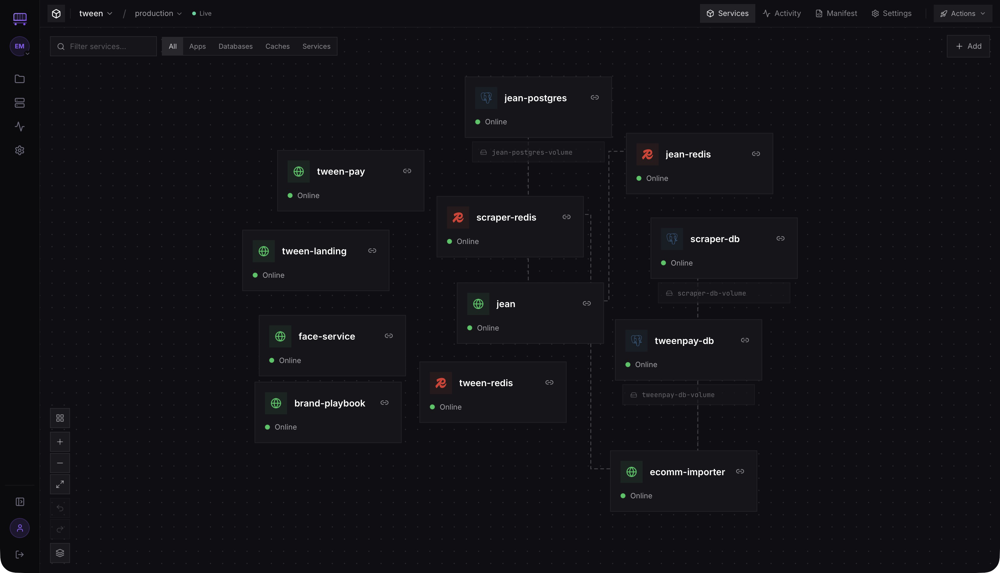
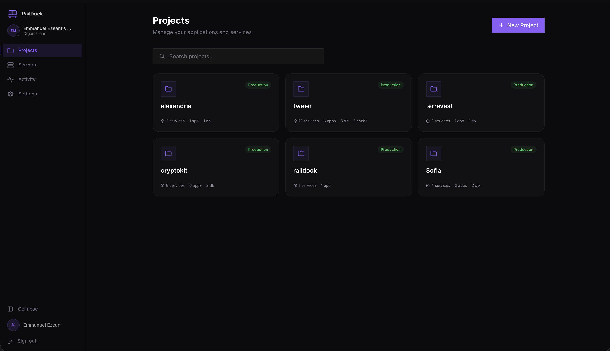
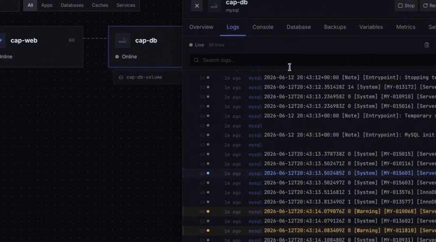
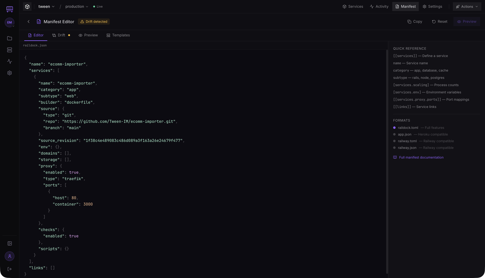
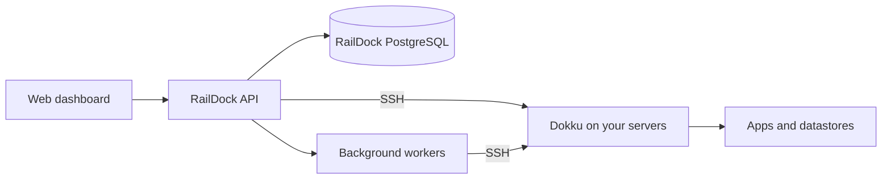

<div align="center">

# RailDock

### Your apps. Your servers. One control plane.

Deploy apps, connect databases, and manage your infrastructure from a self-hosted dashboard.

[](https://github.com/mona-chen/raildock/actions/workflows/ci.yml)
[](LICENSE)
[](https://dokku.com)

[Quick start](#quick-start) · [Product tour](#product-tour) · [Development](#development) · [Contributing](#contributing)

</div>



RailDock is an open-source, self-hosted platform for running applications on your own Linux servers. Deploy from Git or a Docker image, link your databases, and manage domains, logs, storage, and backups in one place.

Use the visual dashboard for day-to-day work, or define your stack in a manifest and review changes before applying them. RailDock manages the control plane; **Dokku runs your workloads over SSH**.

## Why RailDock?

- **See your whole stack.** A service canvas brings apps, databases, persistent volumes, and their connections into one view.
- **Deploy the way you work.** Use Git repositories, Docker images, or one-click templates. Follow deployment logs and roll back to an earlier deployment.
- **Keep infrastructure in code.** Preview manifest changes, resolve cross-service variables, and deploy services in dependency order.
- **Operate from one dashboard.** Manage multiple servers, custom domains, SSL, environment variables, metrics, and interactive terminals.
- **Build recovery into your workflow.** Schedule database and volume backups, use encrypted S3-compatible destinations, and configure PostgreSQL WAL archiving and recovery drills.
- **Work with your team.** Organizations, roles, invitations, shared project variables, and deploy keys are built in.

## Quick start

You need a **Linux server**, `curl`, and administrative access. The installer provisions Docker and Dokku when they are missing. RailDock listens on **port 8888** by default, leaving ports 80 and 443 for your applications.

```bash
curl -sSL https://raw.githubusercontent.com/mona-chen/raildock/main/install.sh | bash
```

Open `http://<your-server-ip>:8888`, create your administrator account, and start your first project.

1. **Choose a server.** Use the automatically configured Local Dokku server or connect a remote host.
2. **Add your services.** Deploy an app from Git or a Docker image and add the databases it needs.
3. **Connect and deploy.** Link services, configure variables and a domain, then follow the deployment from the dashboard.

<details>
<summary><strong>Installation options and existing Traefik setups</strong></summary>

Choose an installation directory:

```bash
curl -sSL https://raw.githubusercontent.com/mona-chen/raildock/main/install.sh | bash -s -- /opt/raildock
```

Reuse an existing Traefik network:

```bash
curl -sSL https://raw.githubusercontent.com/mona-chen/raildock/main/install.sh | bash -s -- \
  --proxy-mode external \
  --external-proxy-network proxy \
  /opt/raildock
```

External mode disables Dokku's managed proxy and applies routing labels for your existing Traefik instance. It does not reconfigure that instance. The installer can also detect an existing Coolify or Traefik proxy automatically.

Optional flags include `--external-proxy-http-entrypoint`, `--external-proxy-https-entrypoint`, `--external-proxy-cert-resolver`, and `--external-proxy-redirect-middleware`.

To build from source or manage only remote hosts, export the options **before** running the installer:

```bash
export BUILD_FROM_SOURCE=1  # build locally instead of pulling the image
# export INSTALL_DOKKU=0   # skip local Dokku installation
# export SKIP_DOKKU_CHECK=1 # bypass the Dokku presence check
curl -sSL https://raw.githubusercontent.com/mona-chen/raildock/main/install.sh | bash
```

</details>

## Product tour

### Your stack, connected

Organize your apps into projects, then explore each stack on its service canvas. Projects support separate environments, including staged duplication and configuration sync.



### From deployment logs to the running app

Inspect deployments, open a container console, and manage domains without leaving the project.



[Watch the full recorded walkthrough (MP4)](media/dashboard-demo.mp4)

### Keep your stack in code

Edit a project manifest alongside a built-in reference, preview the changes, and review drift between the manifest and live services.



*The tour uses captures from a running RailDock instance. The recorded walkthrough shows an earlier version of the interface.*

## What you can run

| Area | Capabilities |
| --- | --- |
| Applications | Git and Docker image deployments; Dockerfile, Nixpacks, and Railpack builders; static sites; scaling and rollback |
| Datastores | PostgreSQL, MySQL, Redis, and MongoDB; app linking and automatic connection variables; read-only data browser |
| Networking | Custom domains, Let's Encrypt SSL, per-project Docker networks, and existing Traefik integration |
| Configuration | Project variables, service variables, persistent storage, and native `raildock.toml` / `raildock.json` manifests |
| Manifest compatibility | Import `railway.toml`, `railway.json`, and Dokku `app.json`; preview changes before applying |
| Recovery | Scheduled backups, volume snapshots, encrypted S3 / R2 destinations, PostgreSQL base backups and WAL archiving, restore drills |
| Operations | Logs, container terminals, server and service metrics, activity history, and remote server provisioning |
| Teams | Organizations, roles, invitations, GitHub App / token integrations, and deploy keys |

### Current scope

RailDock is actively developed. Evaluate it with your workloads and recovery requirements before adopting it.

- You can manage many servers, but **each project runs on one server**.
- Environments can be created, duplicated, and synced. Automatic pull-request preview environments are not implemented.
- The data browser is read-only; there is no built-in SQL query editor.
- There is no self-service password reset flow yet.
- Email invitations require SMTP. Without SMTP, share the invitation link manually.

## How it works



The React frontend and Rails API ship together in one Docker image with nginx and background workers. RailDock stores configuration and history in PostgreSQL and uses Dokku's native deployment and datastore commands to operate workloads.

Read the [architecture guide](docs/architecture.md) for the manifest reconciler, deployment pipeline, networking, and realtime channels.

## Updates and backups

From the installation directory:

```bash
cd /opt/raildock
./scripts/backup.sh
./install.sh update
```

Keep a copy of `.env`, `backend/config/master.key`, the RailDock database, and any local backup artifacts on durable storage. Save destination recovery keys off-host so encrypted service backups remain usable after losing the server.

For remote provisioning, backup and restore commands, SMTP configuration, and deployment security settings, see the [operations guide](docs/operations.md).

## Development

The development stack uses Docker Compose with live reload for Rails and Vite.

```bash
git clone https://github.com/mona-chen/raildock.git
cd raildock
make setup-dev
make start
```

Open `http://localhost:5173`. The Rails API runs on `http://localhost:3001`.

On macOS, you can explore the UI with the Dokku simulator:

```bash
make start-sim
make seed-demo
```

The demo account is `admin@raildock.local` / `changeme123`. The simulator supports UI and control-plane development; it does not build or run deployed apps. Use a Linux host or VM to test real deployments.

| Command | Purpose |
| --- | --- |
| `make test` | Run frontend tests |
| `make test-backend` | Run backend RSpec tests |
| `make logs` | Follow development logs |
| `make console` | Open the Rails console |
| `make db` | Open PostgreSQL |
| `make stop` | Stop the development stack |

See [AGENTS.md](AGENTS.md) for project layout and implementation conventions.

## Contributing

Bug reports, documentation improvements, and focused pull requests are welcome.

- [Report a bug](https://github.com/mona-chen/raildock/issues/new) with reproduction steps, your RailDock version, and relevant logs with secrets removed.
- [Suggest a feature](https://github.com/mona-chen/raildock/issues/new) by describing the workflow it would improve. Open an issue before starting a large change.
- Submit a focused pull request, follow the existing Rails / React style, and run the relevant tests.

Planned work includes password reset, pull-request preview environments, a query console, and improved alerting. The [issue tracker](https://github.com/mona-chen/raildock/issues) is the place to discuss priorities.

## License

[MIT](LICENSE) · Copyright © 2026 RailDock Contributors
